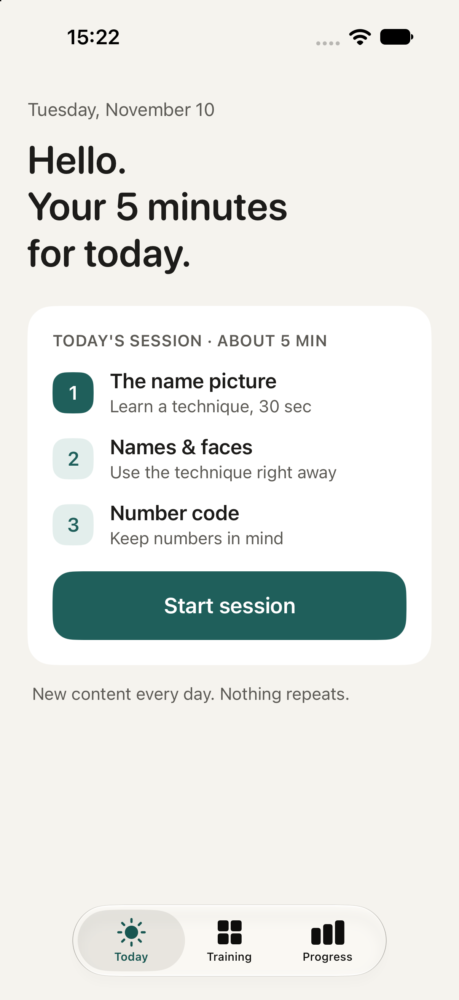
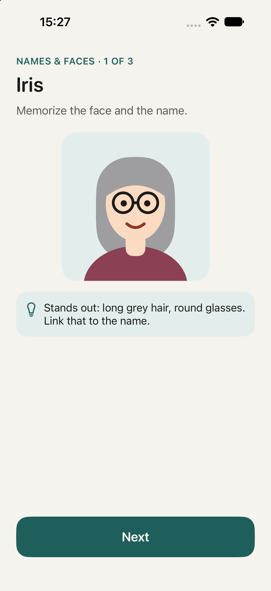
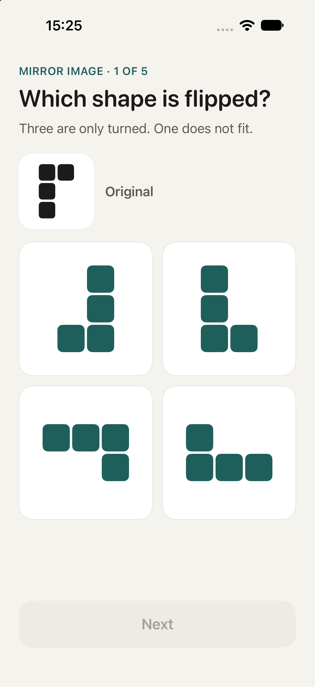
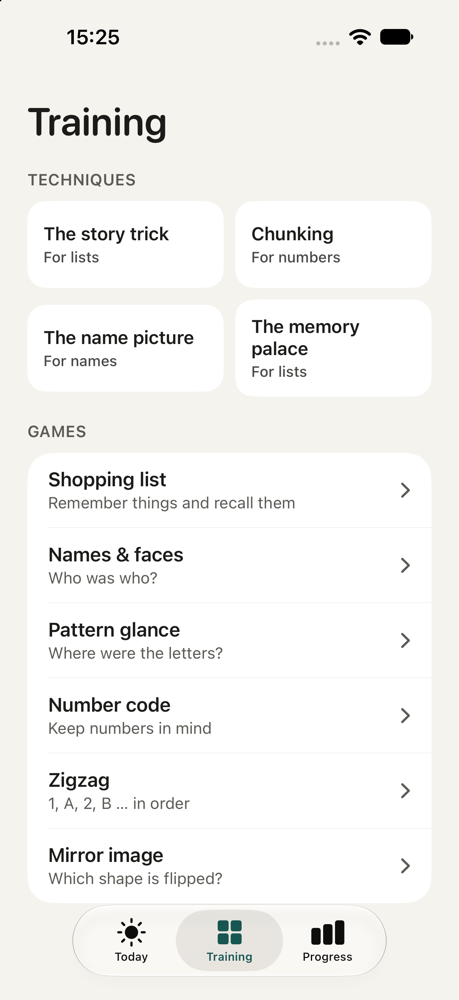

# MemoryGame

MemoryGame is a bilingual iOS app for short, approachable memory-training sessions. It combines practical memorization techniques with six adaptive exercises and keeps progress locally on the device.

<p align="center">
  
  
  
  
</p>

## Features

- Six exercises: shopping lists, names and faces, pattern recall, number codes, alternating sequences, and mirrored shapes
- Daily training plans that pair a memory technique with two exercises
- Adaptive difficulty for each exercise based on recent results
- Progress tracking, personal bests, and streaks with one grace day per week
- German and English interface and content
- Local persistence with no account or network connection required
- Native SwiftUI interface with no third-party dependencies

## Requirements

- Xcode 15 or later
- iOS 17 or later

## Run locally

1. Clone the repository:

   ```sh
   git clone https://github.com/michelherszak/memorygame.git
   cd memorygame
   ```

2. Open `MemoryGame.xcodeproj` in Xcode.
3. Select an iOS simulator or a connected device.
4. Build and run the `MemoryGame` scheme.

## How it works

The app stores scores, difficulty levels, completed days, and learned techniques in `UserDefaults`. Each game has an independent hidden difficulty level from 1 to 10. Strong results raise the level, while weaker results lower it so sessions remain challenging without becoming discouraging.

All training content is bundled with the app. Recently used prompts are temporarily excluded from selection to keep repeat sessions varied.

## Project structure

- `MemoryGameApp.swift` sets up the app, navigation, and game routing.
- `Core.swift` contains shared models, state, localization, theming, and daily-plan logic.
- `Content.swift` contains the German and English training content and memory techniques.
- `MemoryGames.swift` and `FocusGames.swift` implement the six exercises.
- `Screens.swift` and `Components.swift` provide the main screens and reusable interface components.
